

  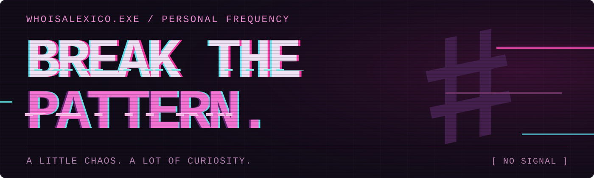

<h3 align="center">Alexey / @whoisalexico</h3>

  <samp>A little chaos. A lot of curiosity.</samp>

<h4 align="center"><samp>TECH / LOADOUT</samp></h4>

<samp>LANGUAGES</samp>

  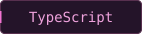
  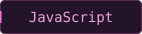
  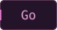
  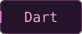
  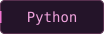
  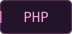

<samp>WEB / RUNTIME</samp>

  
  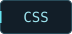
  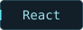
  
  

<samp>INFRA / DATA</samp>

  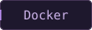
  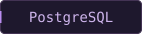

  
  &nbsp;
  

 

  <samp>BREAK THE PATTERN.</samp>

